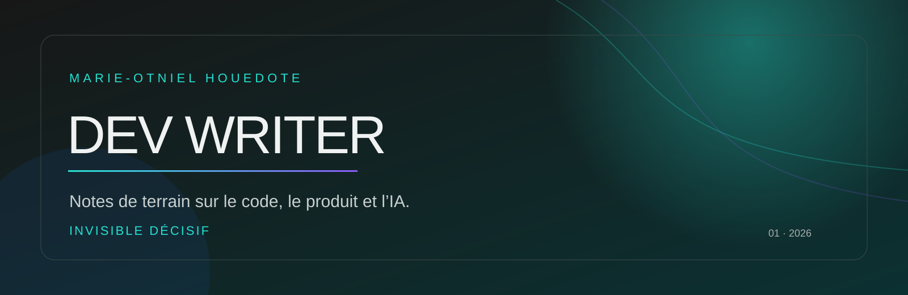

# DEV WRITER · Notes de terrain

### Construire. Écrire. Comprendre.

Un espace public où je documente ce que j’apprends en construisant des produits numériques : développement Full Stack, architecture SaaS, intelligence artificielle, design d’interface et copywriting.

  

---

## Pourquoi ce dépôt existe

Je crois qu’un produit devient plus fort lorsqu’on prend le temps d’expliquer les décisions qui le composent. Ici, je partage les coulisses : les choix d’architecture, les erreurs qui coûtent cher, les méthodes de conception, les intégrations IA et les mots qui rendent une interface plus claire.

> **Pas de contenu pour remplir un calendrier.** Des notes utiles, écrites à partir de projets réels et de problèmes réellement rencontrés.

## Les rubriques

| Rubrique | Ce que tu y trouveras |
|---|---|
| **Architecture** | SaaS, choix de stack, sécurité, données et infrastructure. |
| **Produit** | Décisions, priorisation, MVP, expérience utilisateur et conversion. |
| **IA appliquée** | Prompts, assistants, RAG, coûts, limites et intégration responsable. |
| **Design & contenu** | Design systems, copywriting, storytelling et clarté des interfaces. |
| **Coulisses** | Ce que j’apprends en construisant Cowri et d’autres produits. |

## Première série de notes

### 01 · [Architecturer un SaaS moderne en 2026](notes/01-architecturer-un-saas-moderne.md)

Les décisions que j’aurais aimé prendre plus tôt : architecture, données, sécurité, coûts et pièges rencontrés avant Cowri.

### 02 · [Intégrer l’IA dans un produit existant sans exploser la facture](notes/02-integrer-ia-produit-existant.md)

Une méthode pragmatique pour ajouter de l’intelligence sans dégrader l’expérience utilisateur ni rendre le produit imprévisible.

### 03 · [Bâtir un design system quand on est seul](notes/03-batir-design-system-seul.md)

Tokens, composants et règles simples pour garder une interface cohérente lorsqu’on construit vite avec peu de ressources.

### 04 · [Concevoir les états avant l’écran](notes/04-concevoir-les-etats-avant-lecran.md)

Une méthode pour concevoir les états de chargement, de vide, de succès et d’erreur avant de finaliser l’écran principal.

### 05 · [Écrire l’interface avant de construire le composant](notes/05-ecrire-interface-avant-composant.md)

Pourquoi le copywriting produit doit précéder les composants : intention, preuve, action, friction et retour.

### 06 · [Transformer l'erreur en opportunité de conversion](notes/06-transformer-erreur-en-opportunite.md)

Comment transformer les messages d'erreur en leviers de guidage et de rétention grâce au copywriting et à l'UX.

### 07 · [L'UI Optimiste — Supprimer la latence par le design](notes/07-ui-optimiste-supprimer-latence.md)

Comment améliorer la performance perçue en affichant les résultats avant la réponse serveur.

### 08 · [La documentation vivante — Pourquoi votre code ne suffit pas](notes/08-documentation-vivante-code-ne-suffit-pas.md)

Comment capturer l'intention et les décisions derrière le code pour rendre vos projets résilients.

## Ma manière de travailler

Je pars d’un problème concret, je rends les hypothèses visibles, je construis une première version utile, puis j’améliore à partir des retours. Le code compte. Les mots comptent. Le détail qui fait comprendre compte encore plus.

## Suivre la suite

Les nouvelles notes seront ajoutées ici au fil des projets. Pour échanger autour d’un produit, d’une interface ou d’une idée à transformer en expérience digitale, tu peux me retrouver sur mon [portfolio](https://marieotniel.lovable.app) ou m’écrire à [houedotemarieotniel@gmail.com](mailto:houedotemarieotniel@gmail.com).

**Invisible décisif.**

