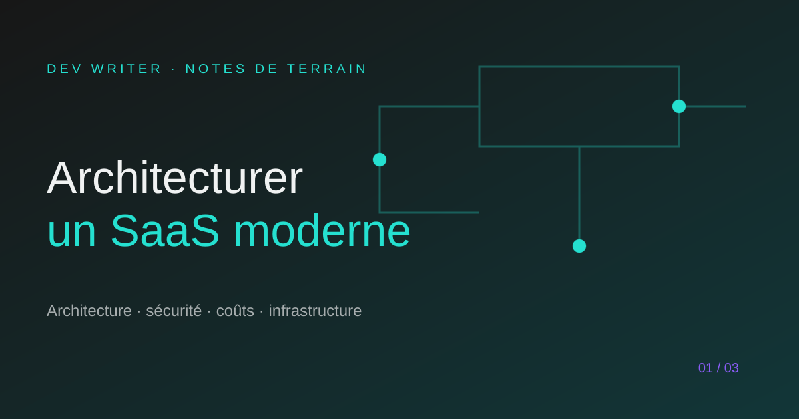

# Architecturer un SaaS moderne en 2026

> Ce que j’aurais aimé savoir avant Cowri.

Construire un SaaS ne commence pas par choisir quinze outils. Cela commence par comprendre ce que le produit doit rendre possible, pour qui, et avec quel niveau de fiabilité.

## 1. Commencer par le chemin critique

Avant de dessiner l’architecture, j’écris le parcours indispensable : inscription, première valeur, action principale, retour utilisateur. Tout ce qui ne sert pas ce chemin peut attendre.

Pour un produit comme Cowri, la question n’est pas seulement « comment stocker les données ? », mais « comment aider un petit commerçant à construire progressivement une identité financière compréhensible ? ».

## 2. Une stack lisible avant une stack impressionnante

Une architecture saine doit pouvoir être expliquée par l’équipe qui la maintient. React ou Next.js pour l’interface, TypeScript pour rendre les contrats visibles, Supabase ou PostgreSQL pour les données, et une couche serveur claire pour les opérations sensibles constituent souvent une base suffisante pour un premier produit sérieux.

La sophistication doit répondre à une contrainte réelle. Sinon, elle devient une dette avant même la première version.

## 3. Séparer les responsabilités tôt

Même dans un petit projet, je distingue les composants d’interface, la logique métier, les accès aux données et les intégrations externes. Cette séparation rend les tests plus faciles et évite qu’un changement de design casse une règle métier.

## 4. Penser aux coûts avant la croissance

Les coûts ne viennent pas uniquement du trafic. Ils viennent aussi des appels IA, des fichiers, des logs, des tâches planifiées et des requêtes mal indexées. Une bonne architecture mesure les opérations coûteuses et prévoit une stratégie de limitation avant que la facture ne devienne une surprise.

## 5. La sécurité n’est pas une étape finale

Les permissions, les secrets, la validation des entrées et la séparation entre données publiques et privées doivent exister dès le premier parcours fonctionnel. Ajouter de la sécurité après le lancement coûte généralement plus cher que de poser les bons garde-fous au départ.

## À retenir

Un SaaS moderne n’est pas une collection de technologies à la mode. C’est un système lisible, sécurisé et suffisamment souple pour apprendre des utilisateurs sans reconstruire chaque fondation.

**La prochaine décision utile vaut mieux que la prochaine abstraction brillante.**

— Marie-Otniel · DEV WRITER
