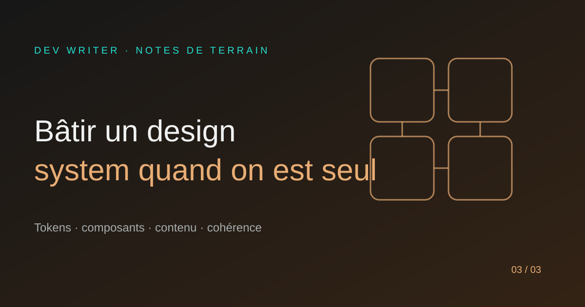

# Bâtir un design system quand on est seul

Un design system n’est pas une bibliothèque de composants gigantesque. C’est un ensemble de décisions répétables qui évite de redessiner le même produit à chaque écran.

## 1. Commencer par les décisions visuelles

Je définis d’abord les couleurs, les contrastes, les typographies, les espacements et les rayons. Ces tokens deviennent le vocabulaire commun de l’interface.

Pour DEV WRITER, la base est volontairement reconnaissable : un fond sombre, un texte clair, un accent teal, quelques touches violettes et une hiérarchie typographique calme.

## 2. Construire les composants par fréquence

Je commence par les éléments qui reviennent partout : boutons, champs, badges, cartes, titres, navigation et messages d’état. Un composant qui n’apparaît qu’une fois n’a pas forcément besoin d’être abstrait immédiatement.

## 3. Documenter les choix, pas seulement le code

Un composant bien nommé peut encore être mal utilisé. Je documente donc son intention, ses variantes, ses états et les situations dans lesquelles il ne faut pas l’utiliser.

## 4. Accepter l’évolution

Un design system vivant change avec le produit. Je préfère quelques règles claires et régulièrement révisées à une bibliothèque parfaite mais trop lourde pour être maintenue.

## 5. Relier design et contenu

La cohérence ne concerne pas uniquement les pixels. Les mots, les longueurs de titres, les messages d’erreur et les appels à l’action font partie du système. Une interface peut être visuellement cohérente et rester difficile à comprendre.

## À retenir

Construire seul ne signifie pas tout faire à la main. Cela signifie rendre les bonnes décisions réutilisables.

**Un bon design system ne se remarque pas. Il donne l’impression que tout était évident depuis le début.**

— Marie-Otniel · DEV WRITER
