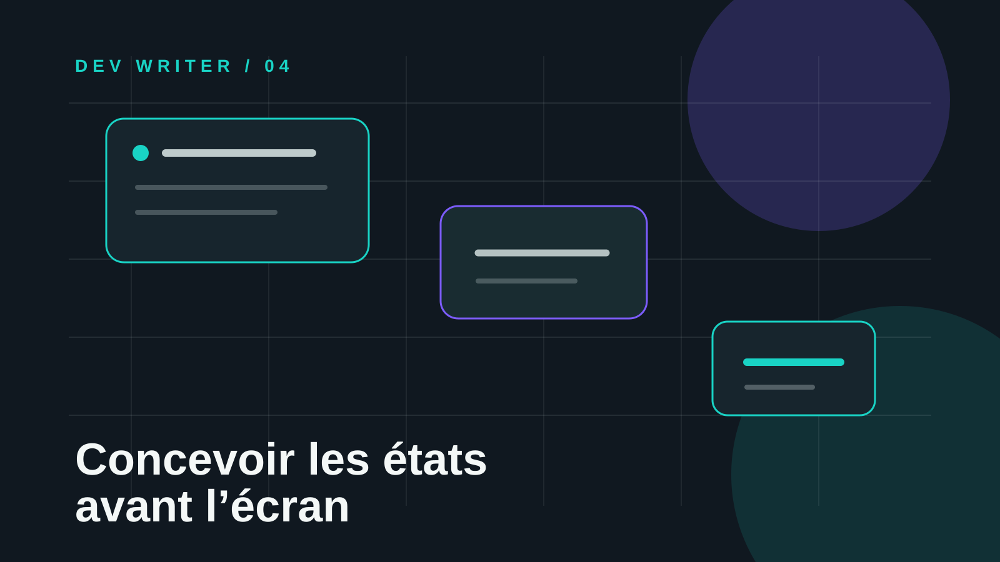

# Concevoir les états avant l’écran : une interface doit savoir quoi dire quand rien ne va

Une interface peut être techniquement fonctionnelle et pourtant sembler inachevée. Le problème apparaît souvent lorsque l’on dessine uniquement l’état idéal : une liste remplie, un formulaire correctement envoyé, une requête qui répond vite et un utilisateur qui ne se trompe jamais.

Le produit réel vit ailleurs. Il doit guider pendant le chargement, expliquer l’absence de données, récupérer une erreur, confirmer une action et permettre de revenir en arrière. Ces moments ne sont pas des détails de finition : ils déterminent si l’utilisateur comprend le système ou l’abandonne.

## Problème

Quand les états secondaires sont repoussés à la fin, ils deviennent des trous dans l’expérience. Un écran vide affiche parfois seulement « Aucun résultat ». Un bouton reste cliquable pendant une requête et peut déclencher deux actions. Une erreur technique apparaît sans expliquer la prochaine étape.

Le symptôme est visuel, mais la cause est souvent une décision produit manquante : personne n’a défini ce que l’interface doit communiquer lorsque la donnée est absente, en attente ou invalide.

## Décision

Je traite chaque fonctionnalité comme un petit système d’états avant de choisir sa composition finale. Pour une liste, je définis au minimum :

- **chargement** : que peut faire l’utilisateur pendant que la donnée arrive ?
- **vide** : pourquoi la liste est-elle vide et quelle action est utile maintenant ?
- **succès** : quelle confirmation montre que le système a compris ?
- **erreur récupérable** : comment réessayer sans perdre le contexte ?
- **erreur bloquante** : que faut-il expliquer et quelle alternative proposer ?
- **hors ligne ou session expirée** : comment préserver l’intention de l’utilisateur ?

Cette décision change l’ordre de travail. Je ne commence plus par « dessiner la page ». Je commence par cartographier les réponses que le produit doit donner.

## Implémentation

Je crée d’abord une matrice simple pour chaque parcours important :

| État | Message attendu | Action proposée | Donnée à préserver |
|---|---|---|---|
| Chargement | « Nous préparons vos projets » | Annuler si l’opération est longue | Filtres et recherche |
| Vide | « Aucun projet ne correspond encore » | Créer un projet ou modifier le filtre | Critères de recherche |
| Succès | « Projet créé » | Ouvrir ou continuer | Identifiant du projet |
| Erreur récupérable | « La sauvegarde n’a pas abouti » | Réessayer | Contenu saisi |
| Session expirée | « Votre session a expiré » | Se reconnecter | Brouillon local |

Côté interface, cela signifie que les composants reçoivent un état explicite au lieu de déduire un comportement à partir d’une valeur absente. Un bouton de sauvegarde peut ainsi distinguer `idle`, `saving`, `saved` et `error`, avec un libellé et une action cohérents pour chaque cas.

Je vérifie ensuite le parcours avec des scénarios volontairement imparfaits : réseau lent, double clic, réponse vide, permission refusée, formulaire partiellement rempli et retour arrière du navigateur. Si l’interface reste compréhensible dans ces situations, elle est généralement plus solide dans le cas nominal.

Cette approche améliore aussi le copywriting. Les messages d’erreur ne décrivent pas seulement ce qui s’est cassé ; ils indiquent ce que la personne peut faire maintenant. « Impossible de charger les projets » devient « Les projets n’ont pas pu être chargés. Vérifiez votre connexion ou réessayez. »

## Leçon

Une interface crédible ne se reconnaît pas uniquement à son écran principal. Elle se reconnaît à la qualité de ses transitions, de ses silences et de ses récupérations.

> Concevoir les états avant les pixels transforme les exceptions en décisions de produit.

Pour un Product Builder, cette méthode réduit les retours tardifs et rend les choix plus faciles à expliquer. Pour un développeur Full Stack, elle clarifie les contrats entre API et interface. Pour un Dev Writer, elle produit des textes qui servent réellement l’action au lieu de remplir les espaces vides.

## Ressource utile

La ressource la plus pratique pour commencer est le guide **Designing better error messages** de [Nielsen Norman Group](https://www.nngroup.com/articles/error-message-guidelines/). Il rappelle qu’un bon message doit être visible, compréhensible, précis sur le problème et orienté vers une solution. À compléter avec la documentation [ARIA live regions de MDN](https://developer.mozilla.org/en-US/docs/Web/Accessibility/ARIA/Guides/Live_regions) pour annoncer les changements d’état importants aux technologies d’assistance.

**Une interface mature ne promet pas que tout se passera bien. Elle sait accompagner l’utilisateur lorsque ce n’est pas le cas.**

— Marie-Otniel · DEV WRITER
