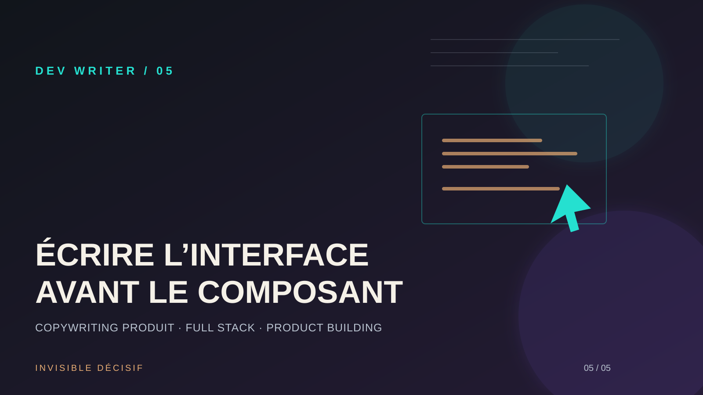

# Écrire l’interface avant de construire le composant

Une interface peut être élégante, responsive et parfaitement codée tout en restant difficile à comprendre. Le problème ne vient pas toujours du design. Il vient parfois du fait que les mots ont été ajoutés après les composants, comme une couche de finition.

## Problème

Quand le contenu arrive trop tard, les décisions produit se cachent dans le code. Un bouton reçoit un libellé provisoire, un formulaire affiche des champs dont l’utilité n’est pas claire et une page d’accueil promet plusieurs choses à la fois. Puis, au moment de remplacer le faux texte, l’interface se décale, les titres deviennent trop longs et les parcours perdent leur intention.

Le symptôme est souvent décrit comme un problème de design ou de conversion. En réalité, l’équipe n’a pas encore répondu à une question simple : **qu’est-ce que la personne doit comprendre et faire à cet endroit précis ?**

## Décision

Je traite le copywriting comme une spécification fonctionnelle légère. Avant de construire le composant, j’écris le rôle de l’écran, la promesse principale, l’action attendue, les objections possibles et les mots qui confirment le résultat.

Je ne cherche pas à rédiger une version définitive dès le premier passage. Je cherche à rendre les décisions visibles. Si je n’arrive pas à expliquer un bouton, une étape ou une section en une phrase, le problème est probablement encore dans le produit, pas dans la formulation.

Pour chaque écran important, je fixe donc cinq éléments :

- **intention** : ce que la personne doit comprendre ;
- **preuve** : ce qui rend la promesse crédible ;
- **action** : ce qu’elle peut faire maintenant ;
- **friction** : ce qui pourrait la faire hésiter ;
- **retour** : ce que le système lui dira après son action.

Cette décision change aussi la collaboration. Le front-end ne reçoit plus seulement une maquette à reproduire. Il reçoit une intention, des contenus réels et les limites à respecter pour que l’interface reste lisible.

## Implémentation

Je commence par un inventaire de contenu très court. Pour une page de création de projet, par exemple :

| Zone | Question à résoudre | Exemple de contenu |
|---|---|---|
| Titre | Où suis-je et pourquoi cette page existe-t-elle ? | « Créer un projet » |
| Introduction | Quel résultat vais-je obtenir ? | « Rassemblez les informations nécessaires au prochain livrable. » |
| Champ | Pourquoi cette donnée est-elle demandée ? | « Nom du projet — il sera visible dans votre espace. » |
| Action principale | Quelle est la prochaine étape ? | « Créer le projet » |
| Confirmation | Comment savoir que c’est terminé ? | « Projet créé. Vous pouvez maintenant ajouter une première tâche. » |

Ensuite, je remplace les textes provisoires par des phrases qui tiennent compte de la largeur réelle des composants. Je teste les variantes longues, les erreurs de saisie, les traductions éventuelles et les écrans mobiles. Un libellé qui fonctionne uniquement avec six caractères n’est pas une décision robuste.

Pour les boutons, je préfère décrire l’action et son résultat plutôt que d’utiliser des mots vagues. « Continuer » peut devenir « Enregistrer le projet » ou « Voir le récapitulatif », selon l’étape. Pour les erreurs, j’indique le problème, la prochaine action et, si possible, la donnée à préserver. Le texte ne doit pas punir la personne pour une limite du système.

Côté code, je sépare les contenus qui relèvent du produit des composants qui les affichent. Une structure de contenu explicite permet de relire les mots sans parcourir toute l’interface et évite de disperser des phrases importantes dans plusieurs fichiers. Elle facilite aussi la vérification des états, l’accessibilité et la traduction.

Enfin, je relis l’écran à voix haute. Cette étape révèle les titres qui promettent trop, les boutons qui ne disent rien et les enchaînements qui semblent logiques pour l’équipe mais pas pour la personne qui découvre le produit.

## Leçon

Le copywriting n’est pas le vernis posé sur une interface déjà décidée. C’est une manière de tester les décisions avant de les rendre coûteuses à modifier.

> Quand les mots sont clairs avant les pixels, le design, le front-end et le produit avancent dans la même direction.

Pour un Product Builder, écrire tôt réduit les ambiguïtés. Pour un développeur Full Stack, cela rend visibles les résultats attendus des actions et les cas à traiter. Pour un Dev Writer, cela transforme chaque écran en explication utile, pas seulement en assemblage de composants.

## Ressource utile

La ressource la plus directement applicable est le guide [Writing for user interfaces](https://www.gov.uk/guidance/content-design/writing-for-user-interfaces) du Government Digital Service. Il propose des principes concrets pour écrire des interfaces compréhensibles et orientées vers l’action. Pour compléter la réflexion sur les libellés et les parcours, la documentation [Button — Material Design](https://m3.material.io/components/buttons/overview) rappelle le rôle des boutons et la nécessité d’utiliser des actions explicites.

**Une interface paraît évidente lorsque ses mots ont été pensés avant ses composants.**

— Marie-Otniel · DEV WRITER
