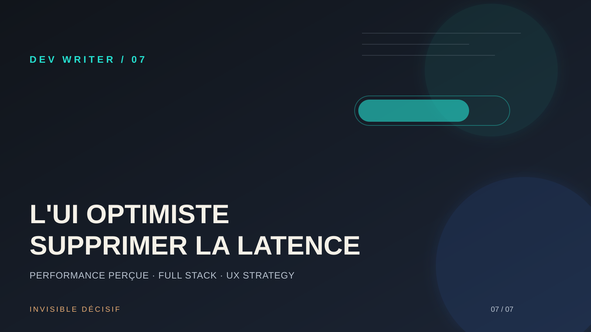

# Note 07 : L'UI Optimiste — Supprimer la latence par le design



## Problème
Dans les applications modernes, chaque action (liker, ajouter au panier, modifier un statut) nécessite un aller-retour serveur. Sur une connexion instable ou lente, ces quelques centaines de millisecondes créent une friction insupportable. L'utilisateur attend que le "spinner" disparaisse avant de savoir si son action a réussi, ce qui brise le sentiment de contrôle et de fluidité.

## Décision
Adopter systématiquement l'**UI Optimiste**. Au lieu d'attendre la réponse du serveur, l'interface affiche immédiatement l'état final souhaité. Si l'utilisateur clique sur "Favoris", l'icône s'illumine instantanément. Le serveur travaille en arrière-plan. En cas d'échec (rare), on effectue un "rollback" (retour en arrière) propre. La priorité est donnée à la **performance perçue**.

## Implémentation

1.  **Anticipation du succès** : Mettre à jour le cache local dès l'interaction. Avec des outils comme **tRPC** ou **React Query**, cela se fait dans le hook `onMutate`.
    ```typescript
    const utils = trpc.useUtils();
    const mutation = trpc.post.like.useMutation({
      onMutate: async (newLike) => {
        await utils.post.get.cancel();
        const prevData = utils.post.get.getData();
        // Mise à jour immédiate du cache local
        utils.post.get.setData(undefined, (old) => ({ ...old, isLiked: true }));
        return { prevData };
      },
      onError: (err, newLike, ctx) => {
        // Rollback en cas d'erreur serveur
        utils.post.get.setData(undefined, ctx.prevData);
      },
    });
    ```

2.  **Gestion de l'échec (Rollback)** : L'erreur doit être gérée de manière "Invisible Décisive". Si la mutation échoue, on remet l'interface dans son état précédent et on affiche une notification discrète mais claire (voir Note 06).

3.  **Feedback de transition** : Bien que l'action soit immédiate, une micro-animation de confirmation (un léger rebond ou un changement de couleur) confirme à l'utilisateur que son intention a été enregistrée.

## Leçon
La fluidité d'un produit ne dépend pas seulement de la puissance du serveur, mais de la confiance qu'on donne à l'interface. En tant que **Dev Writer**, mon rôle est de faire disparaître la technique derrière l'expérience. L'UI Optimiste transforme une application "réactive" en une extension naturelle de la pensée de l'utilisateur.

## Ressource utile
[Optimistic Updates - TanStack Query](https://tanstack.com/query/latest/docs/framework/react/guides/optimistic-updates) — La documentation officielle pour implémenter ces concepts avec robustesse dans un environnement React moderne.

---
*Marie-Otniel · Le Dev Writer*
