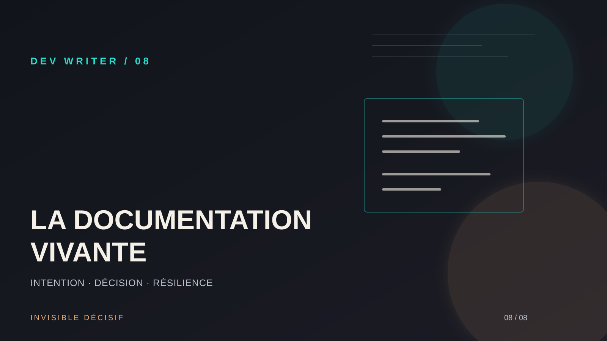

# Note 08 : La documentation vivante — Pourquoi votre code ne suffit pas



## Problème
On entend souvent que "le code bien écrit se documente tout seul". C'est un mythe dangereux. Si le code explique le *comment* (la logique technique), il est presque toujours muet sur le *pourquoi* (l'intention business, les compromis faits, les alternatives rejetées). Sans cette trace, trois mois plus tard, modifier une fonction devient un risque, car on ne comprend plus le contexte qui a mené à cette implémentation précise.

## Décision
Adopter la **documentation vivante** intégrée au cycle de développement. La décision est de ne plus traiter la documentation comme une tâche séparée en fin de projet, mais comme une composante du code lui-même. Nous utilisons des **ADR (Architecture Decision Records)** simplifiés et des README contextuels pour capturer l'intelligence du produit au moment où elle est produite.

## Implémentation

1.  **Architecture Decision Records (ADR)** : Créer un dossier `docs/decisions` à la racine du projet. Chaque décision importante (choix d'une base de données, stratégie d'authentification) fait l'objet d'un fichier Markdown daté et numéroté.
    ```markdown
    # ADR 001 : Choix de Drizzle ORM sur Prisma
    Date : 2026-09-14
    Statut : Accepté
    Contexte : Besoin de performances maximales et de contrôle sur le SQL généré.
    Décision : Utiliser Drizzle pour son approche "TypeScript-first" et sa légèreté.
    Conséquences : Moins d'abstraction, mais une meilleure visibilité sur les requêtes.
    ```

2.  **README contextuels** : Au lieu d'un seul README géant, placer des fichiers `README.md` dans les sous-dossiers critiques (ex: `/server/auth`) pour expliquer les spécificités locales et les pièges à éviter.

3.  **Commentaires d'intention** : Dans le code, privilégier les commentaires qui expliquent la contrainte métier plutôt que la boucle `for`.
    > `// On utilise un polling ici car l'API partenaire ne supporte pas encore les webhooks.`

## Leçon
La documentation est une assurance contre l'oubli. Pour un **Product Builder**, elle permet de transmettre la vision du produit aux futurs collaborateurs (ou à soi-même dans le futur). Un code sans "pourquoi" est un code mort. La documentation vivante rend le projet résilient et facilite le passage à l'échelle.

## Ressource utile
[Architecture Decision Records (ADR)](https://adr.github.io/) — Le site de référence pour comprendre les différents formats d'ADR et comment les intégrer efficacement dans vos workflows de développement.

---
*Marie-Otniel · Le Dev Writer*
