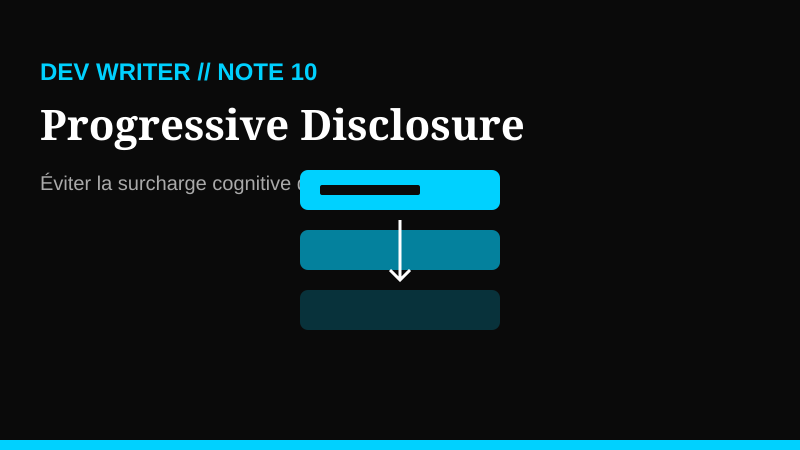

# Note 10 : La stratégie du "Progressive Disclosure" — Éviter la surcharge cognitive

## Problème
Lorsqu'on construit un SaaS ou un outil complexe, la tentation est grande de montrer toutes les fonctionnalités, tous les champs de formulaire et tous les boutons dès le premier écran. Résultat ? L'utilisateur est paralysé par la complexité (loi de Hick). Une interface surchargée fait fuir les nouveaux arrivants et ralentit les experts.

## Décision
Adopter la méthode du **Progressive Disclosure** (divulgation progressive). L'idée est simple : ne montrer que l'essentiel au moment où l'utilisateur en a besoin. On cache les options avancées derrière des menus contextuels, des onglets ou des étapes successives. C'est le passage d'une interface "tout-en-un" à une interface "juste-à-temps".

## Implémentation

1.  **Hiérarchisation des actions** : Identifiez les 20% d'actions utilisées 80% du temps. Ce sont les seules qui doivent être visibles par défaut.
2.  **L'art du "Show More"** : Utilisez des composants comme les accordéons, les tiroirs (drawers) ou des sections "Options avancées" pour isoler les réglages secondaires.
3.  **Le Wizard Pattern** : Pour les formulaires longs, divisez la saisie en plusieurs étapes. La barre de progression devient un moteur psychologique plutôt qu'une contrainte.
4.  **Tooltips contextuels** : Au lieu d'expliquer une fonctionnalité complexe dans un long paragraphe, utilisez des icônes d'information au survol.

## Leçon
En tant que **Product Builder**, votre rôle n'est pas de tout montrer, mais de guider. Moins vous en montrez, plus l'utilisateur a l'impression que votre produit est facile à utiliser, même s'il est techniquement surpuissant sous le capot. La clarté gagne toujours sur la densité.

## Ressource utile
[Interaction Design Foundation - Progressive Disclosure](https://www.interaction-design.org/literature/topics/progressive-disclosure) — Une base théorique solide pour approfondir ce concept fondamental en UX.

---
*Marie-Otniel · Le Dev Writer*
